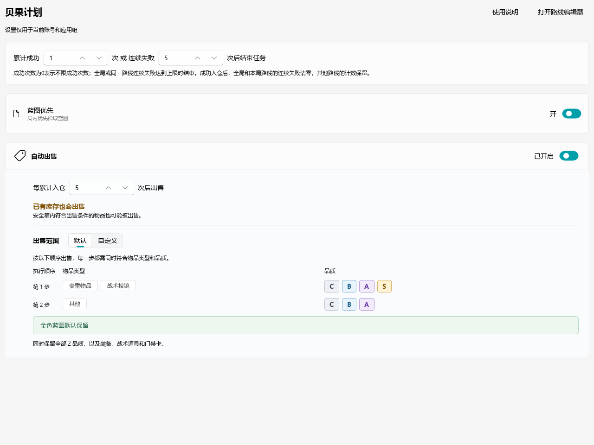

# 贝果计划

贝果计划自动跑刀。以插件形式安装，在「应用运行」里单独启动，支持自定义路线。

[觉得插件好用的话，欢迎到 GitHub 点个 Star ⭐↗](https://github.com/Cora093/zzz-bagel-plugin)

## 安装

1. 左侧导航进入「应用运行」，点「添加应用」。
   
2. 在列表里找到「贝果计划」，选中后点「确定」。
   

## 设置

- **累计成功次数**：达到这个次数就结束任务。填 0 表示一直循环，直到仓库满。
- **累计失败次数**：失败后自动重开的次数，超过就停止并留下现场。
- **蓝图优先**：打开后局内优先拾取蓝图。
- **自动出售**：每累计入仓若干次后自动卖一次。注意「已有库存也会出售」——安全箱里符合出售条件的物品同样会被卖掉。
- **出售范围**：按顺序执行，每一步要同时满足物品类型和品质。默认两步：先「贵重物品 + 战术棱镜」的 C/B/A/S，再「其他」的 C/B/A。想自己定就切到「自定义」。

## 路线

这个应用除了路线，其它都不需要你操心；**路线决定了每局能拿多少东西**。

### 预设路线为什么保守

随插件带的 5 条默认路线是照着「谁都能跑完」的目标录的：多打途径点、绕开狭窄处、宁可多走两步也不赌贴墙。
录它的人用的角色、移速、账号练度和你不一样，他敢冲的地方你冲过去可能就卡住了。

所以预设只是让你能立刻跑起来。想要更高的效率，路线一定要自己录一条：

- 你的角色走得快，可以把长直路段的途径点拉远。
- 你熟悉箱子分布，可以改走箱子更密的路线。
- 你想专攻保险箱，可以把路线上的一切无关箱子砍掉。

### 录一条自己的路线

1. 在应用卡片右上角点「打开路线编辑器」。
   
2. 点「录制路线」，选好出生点，游戏会自动切到前台。
3. **站到出生点上，按 `1` 打第一个途径点**。首个点必须落在该出生点的识别半径内，否则这条路线绑不上这个出生点。
4. 走到下一个位置，按对应数字打点：

   | 按键 | 点位类型 |
   | --- | --- |
   | `1` | 途径点 |
   | `2` | 电子保险箱 |
   | `3` | 机械保险箱 |
   | `4` | 普通箱子 |
   | `5` | 门 |
   | `6` | 电梯 |

5. 打错了按 `退格` 删掉上一个点。
6. 点「停止录制」保存。

路线只记坐标和点位类型，不记动作。走到点上该开箱还是该交互，由程序当场识别画面决定，所以路线画得越贴合你的实际走法，跑起来越顺。

### 编辑与试跑

右侧「出生点与路线」里，每个出生点下面挂着它的路线。

- 默认路线只读，点「复制」得到一份自己的副本再改。复制出来的副本可以随意拖节点、插点、删点。
- 地图上滚轮缩放，空白处拖动，点「适应」把整条路线框进视野。
- 改完点「试跑」：程序会切到游戏，按路线走一遍，走完不衔接结算。先用它验证路线通不通。
- 每个出生点同时只能开启一条路线（右侧那个开关）。

### 出生点没有预设路线怎么办

预设路线覆盖 5 个出生点，其中只有 3 个是新装时自动开启的（录像店、白鸽工地站、六昏街南站），另外两条默认关闭。出生点清单里一共 11 个出生点，其余都没有预设路线，自己录一条再开启就行。

## 分享你的路线

录出一条又快又稳的路线，欢迎到本插件所在仓库提 PR，让它变成别人的默认路线。

要提交的东西：

1. 路线文件放 `bagel/assets/game_data/bagel/routes/`，文件名必须是 `<route_id>.sample.route.json`（程序会核对文件名与 `route_id` 一致）。
2. 把路线里的 `route_id` 和 `name` 都改成有辨识度的名字，例如 `录像店-速刷`。**不要带 `custom_` 前缀**：那是本地自定义路线的标识格式，带这个前缀的路线，用户点「复制」时会被按自定义标识去校验，中文名对不上会直接报错。
3. 想让它成为新用户的默认路线，就在 `bagel/assets/game_data/bagel/spawn_points.yml` 里给对应出生点填 `initial_route`；只是分享、不默认开启就保持 `null`。

PR 里请写清楚：用的出生点、走法要点（为什么这么绕）、适合什么练度和角色、大概能开多少箱子。有截图或录屏更好。

## 文件放在哪

| 内容 | 位置 |
| --- | --- |
| 默认路线（只读，随插件分发） | `plugins/bagel/bagel/assets/game_data/bagel/routes/` |
| 出生点清单 | `plugins/bagel/bagel/assets/game_data/bagel/spawn_points.yml` |
| 你复制的自定义路线 | 工作目录 `plugin_data/zzz-bagel-plugin/bagel/routes/custom_*.route.json` |
| 每个出生点当前开启的路线 | 工作目录 `plugin_data/zzz-bagel-plugin/bagel/route_settings.yml` |
| 路线数据记录 | 工作目录 `plugin_data/zzz-bagel-plugin/bagel/route_records.jsonl` |
| 失败现场截图 | 工作目录 `plugin_data/zzz-bagel-plugin/bagel/screenshots/` |

运行期数据都放在工作目录的 `plugin_data/zzz-bagel-plugin/bagel/` 下，跟插件目录分开：插件升级会整个替换插件目录，数据放在里面会被一起删掉，放在外面就不会。默认路线在插件里，随插件分发，只读。

## 常见问题

**启动就报「没有开启的贝果路线」**
打开路线编辑器，给出生点开启一条路线。刚安装时只有 3 个出生点会自动开启。

**默认路线改不动**
它是只读的。点「复制」，在副本上改。

**换了工作目录，自定义路线不见了**
自定义路线存在工作目录的 `plugin_data/zzz-bagel-plugin/bagel/routes/` 下，换目录前先把整个 `plugin_data/zzz-bagel-plugin/bagel/` 拷过去。

**跑起来总是卡在墙角**
这是路线偏保守之外的另一种情况：你的角色移速比录路线时快。把长直路段的途径点拉远一点，或者在拐角前多打一个点。

## 来源与许可

主程序上游为 OneDragon-Anything/ZenlessZoneZero-OneDragon。

本仓库采用 GNU GPL v3。后续迁入代码时保留原版权与许可证说明，并记录代码及素材来源。
